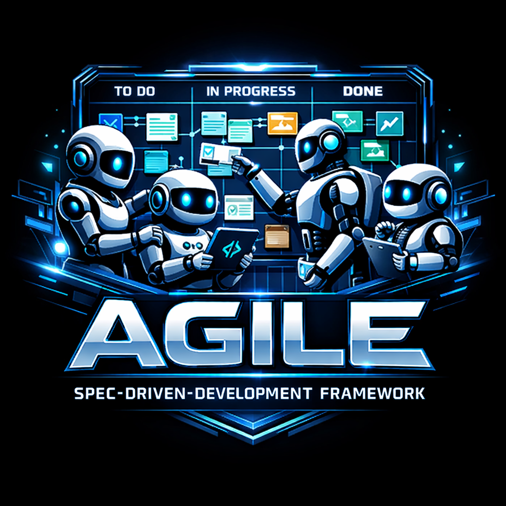
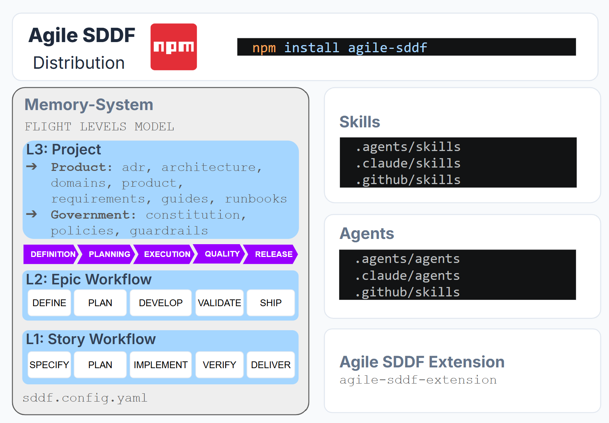
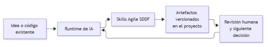
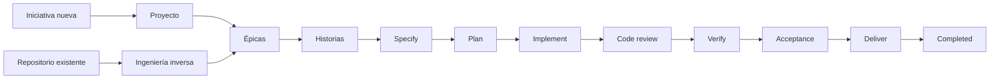

<p align="center">
  
</p>

# Agile SDDF — Spec-Driven Development Framework

[](https://npmjs.com/package/agile-sddf)
[](https://github.com/dariopalminio/agile-sddf/actions/workflows/quality.yml)
[](LICENSE)

Agile SDDF convierte una idea —o un repositorio que ya existe— en especificaciones, épicas, historias, planes y evidencia de calidad versionados junto al código. En lugar de depender de un chat efímero o de prompts improvisados, el equipo y su runtime de IA trabajan sobre artefactos Markdown trazables.

El framework instala skills en el runtime que elijas y conserva la fuente de verdad en tu repositorio. Tú marcas las decisiones y los gates importantes; SDDF estructura el recorrido y deja evidencia de cada fase.


> *"Resumen visual. La máquina de estados precisa, con subestados, transiciones de rework y `phase_type`, vive en `domain-state-management.md` y `domain-story-lifecycle.md`."*


| De un vistazo | Empieza por aquí |
|---|---|
| Instalar el paquete | `npm install agile-sddf` |
| Instalar skills en un runtime | `npx agile-sddf install --target claude-code` |
| Preparar un repositorio | `/sddf-init [--level minimal\|standard\|full]` |
| Empezar una iniciativa | `/project-flow` |
| Entender código existente | `/reverse-engineering` |
| Completar e indexar la memoria del proyecto (`docs/`) | `/memory-system` (`ensure`; `scaffold`, `rebuild --force`, `index`) |
| Verificar que la memoria es consistente (gate de CI) | `/memory-system check [--json]` |
| Profundizar | [Índice de documentación](docs/index.md) |

---

## Índice

**Empezar**

- [Para quién](#para-quien)
- [Qué incluye](#que-incluye)
- [Empieza en cinco minutos](#empieza-en-cinco-minutos)
- [Tu primera historia](#tu-primera-historia-flujo-completo)
- [Si algo se traba](#si-algo-se-traba)

**Entender y extender**

1. [Modelo mental](#modelo-mental)
2. [Flujo y evidencia](#flujo-y-evidencia)
3. [Artefactos que deja el flujo](#artefactos-que-deja-el-flujo-memoria)
4. [Monorepo o polirepo](#monorepo-o-polirepo)
5. [Instalación en tu runtime](#installation)
6. [Configuración](#configuracion)
7. [Referencia para profundizar](#referencia-para-profundizar)
8. [Actualizar desde versiones anteriores](#actualizar-desde-versiones-anteriores)
9. [Contribuir](#contribuir)
10. [Seguridad](#seguridad)
11. [Licencia](#licencia)

---

## Para quién

SDDF sirve si:

- Trabajas con un runtime de IA compatible y quieres que el contexto del producto sobreviva a las sesiones de chat.
- Vas a iniciar un producto, convertir un plan en backlog o adoptar un repositorio con código existente.
- Prefieres que requisitos, criterios de aceptación, decisiones técnicas y resultados de calidad sean archivos revisables en Git.
- Quieres combinar autonomía de agentes con gates explícitos de revisión humana, WIP controlado y trazabilidad.

No es:

- Una librería que se importa dentro de tu aplicación.
- Un reemplazo de tu runtime de IA, de Git, de tu stack de pruebas ni del criterio de tu equipo.
- Un generador que elimine decisiones de producto o arquitectura: SDDF las hace visibles y las lleva a los documentos que corresponden.

## Qué incluye

| Pieza | Dónde vive | Para qué sirve |
|---|---|---|
| Skills del framework | `skills/` | Guían los flujos de proyecto, épicas, historias, planificación, implementación y verificación. |
| Roles y subagentes locales | dentro de cada skill, en `skills/<skill>/` | Especializan un paso del skill y se instalan con él. |
| Instalador y contratos | `scripts/` y `config/` | Copian solo los artefactos admitidos en el runtime elegido y validan sus contratos. |
| Configuración del proyecto | `sddf.config.yaml` | Define perfil, stack, comandos de verificación y workers opcionales. |
| Memoria | `docs/` | Conocimiento: producto, requisitos, dominio, arquitectura, decisiones, guías y templates. |
| Políticas del proyecto | `docs/policies/` y `docs/guardrails/` | Registran principios técnicos y Definition of Done para los gates del flujo. |
| Work items | `specs/flow/` | Épicas e historias con sus planes y reportes; las historias completadas y canceladas se archivan en `specs/flow/archive/`. |
## Empieza en cinco minutos

Necesitas Node.js 18 o superior y uno de los runtimes compatibles. La instalación tiene dos pasos deliberadamente separados: descargar el paquete y copiar sus artefactos en el runtime.

### 1. Instala el paquete y elige un runtime

```bash
npm install agile-sddf
npx agile-sddf install --target claude-code
```

El segundo comando es explícito a propósito: `npm install` no crea directorios de runtime ni instala skills por sí solo. Consulta [Instalación en tu runtime](#installation) para elegir otro destino.

### 2. Inicializa SDDF dentro de tu repositorio

Abre el repositorio con tu runtime de IA e invoca:

```text
/sddf-init
```

Es idempotente: prepara `specs/`, templates compartidos, `sddf.config.yaml` y `.env.template` sin sobrescribir lo que ya existe. También puede inicializar las políticas del proyecto si decides hacerlo.

Con `--level` eliges el alcance: `minimal` (solo directorios base, `sddf.config.yaml` y `.env.template`, sin preguntas; útil en CI), `standard` (el valor por defecto, descrito arriba) o `full` (recomendado para proyectos nuevos: `standard` más `/memory-system scaffold`, que completa las capas de la memoria del proyecto en el mismo comando).

### 3. Elige el punto de entrada que se parece a tu situación

| Situación | Invoca | Qué obtienes |
|---|---|---|
| Una iniciativa nueva | `/project-flow` | Intención, discovery de requisitos y plan de épicas con gates entre fases. |
| Un repositorio con código | `/reverse-engineering` | Una especificación de proyecto basada en análisis paralelo del código y la documentación existente. |
| Un roadmap aprobado | `/epic-from-project-plan` | Directorios de épica a partir de `product/roadmap.md`. |
| Una necesidad puntual | `/story-specify` | Una historia refinada con criterios Gherkin y evaluación FINVEST. |

> `/skill-preflight` es un diagnóstico explícito y de solo lectura. Úsalo bajo demanda para inspeccionar la raíz efectiva, la estructura y los templates; no forma parte de los flujos normales.

## Tu primera historia (flujo completo)

Cuando ya existe un `product/roadmap.md`, el camino habitual es este:

```text
/epic-from-project-plan
        ↓
/epic-generate-stories EPIC-01-mi-epica
        ↓
/story-specify
        ↓
/story-plan STORY-001
        ↓
/story-implement STORY-001
        ↓
/story-code-review → /story-verify → /story-acceptance
        ↓
/story-delivery → /story-complete
```

Cada etapa produce algo que se puede leer y revisar:

| Etapa | Skill principal | Evidencia principal |
|---|---|---|
| Especificar | `/story-specify` | `story.md`, evaluación FINVEST y, si corresponde, mejora o división de la historia. |
| Planificar | `/story-plan` | `design.md`, `tasks.md`, `testcases.md` y `analyze.md`. |
| Implementar | `/story-implement` | Ciclo TDD configurable RED → GREEN → REFACTOR e `implement-report.md`. |
| Revisar | `/story-code-review` | `code-review-report.md` o `fix-directives.md` si hay correcciones pendientes. |
| Verificar y aceptar | `/story-verify` y `/story-acceptance` | `verify-report.md` y `acceptance-report.md`. |
| Entregar | `/story-delivery` | `story.md` en `DELIVER/DONE` tras verificar el DoD de entrega. |
| Completar y archivar | `/story-complete` | `story.md` en `COMPLETED/DONE` dentro de `specs/flow/archive/<YYYY-MM-DD>-STORY-NNN-<slug>/`. |
| Completar y archivar épica | `/epic-complete` | `epic.md` en `COMPLETED/DONE`, con fecha de cierre y versión liberada, dentro de `specs/flow/archive/<YYYY-MM-DD>-EPIC-NN-<slug>/`. |

`/story-implement` orquesta el ciclo TDD y los workers configurados para tu stack. Si necesitas ejecutar una historia tarea por tarea en el flujo SDD, usa `/story-implement-tasks`.

> **Para generar tests y código mediante workers:** el perfil `core` inicializa esas entradas como `skill: none`. Instala workers propios o de [agile-sddf-extension](https://github.com/dariopalminio/agile-sddf-extension) y decláralos en `sddf.config.yaml` antes de pedir esa delegación; sin ellos, `/story-implement` no tiene generadores que invocar.

## Si algo se traba

| Síntoma | Qué revisar |
|---|---|
| “Instalé el paquete y no aparecen los skills” | Es esperado tras `npm install`. Ejecuta `npx agile-sddf install --target <runtime>`. |
| El skill no encuentra los work items o avisa de layout legado | Pide el diagnóstico explícito `/skill-preflight`: detecta el layout legado (`docs/specs/`, la clave `root`, `SDDF_ROOT`) y remite a la [guía de migración](docs/guides/artifact-directory-migration.md#migracion-a-500--layout-fijo-de-tres-raices). |
| Un worker de implementación no existe | Decláralo como `skill: none` o instálalo y configúralo antes de invocar `/story-implement`; los workers requeridos fallan rápido. |
| Una historia necesita correcciones tras el review | Lee `fix-directives.md` y vuelve a `/story-implement`; el artefacto señala la ronda de rework. |
| Quieres retomar trabajo pendiente | Localiza el documento con `substatus: IN-PROGRESS` y reanuda el skill que generó el artefacto. |
| Estás usando Codex | Usa `--target codex`, no `--target .agents`: este último no es un target válido. |

---

## Modelo mental

SDDF separa el kit distribuido, la instalación del runtime y los artefactos de cada proyecto. La conversación activa ayuda a avanzar, pero los archivos versionados son la fuente de verdad que heredan las siguientes sesiones.



| Capa | Responsabilidad | Fuente de verdad |
|---|---|---|
| Paquete SDDF | Distribuye skills, agentes, scripts y contratos. | Este repositorio y el paquete npm. |
| Runtime instalado | Hace disponibles los artefactos compatibles para tu asistente de IA. | El target elegido en [`config/runtimes.json`](config/runtimes.json). |
| Memoria | Guarda la intención, el diseño, las decisiones, la evidencia, las políticas y los specs. | `docs/` y `specs/` en la raíz de tu repositorio. |

## Flujo y evidencia

El framework organiza el trabajo por niveles, no por una secuencia de prompts aislados. Puedes entrar desde una idea o desde el código, pero todas las rutas convergen en artefactos revisables.



| Nivel | Objetivo | Entrada frecuente | Salidas observables |
|---|---|---|---|
| Producto (estratégico) | Entender qué se construye y por qué. | `/project-flow` | `product/vision.md`, `product/stakeholders.md`, `requirements/`, `product/roadmap.md`. |
| Épica (L2) | Agrupar una parte entregable del plan (conjunto de historias). | `/epic-from-project-plan` | `epic.md`. |
| Historia (L1) | Definir, planificar, construir y validar un cambio pequeño. | `/story-specify` | Historia, diseño, tareas, tests, reportes y aceptación. |

Los únicos work items son Épica e Historia; la documentación de producto los orienta, pero no tiene ciclo de work item. El modelo está en la [jerarquía de work items](docs/domains/domain-work-item-hierarchy.md).

El ciclo de vida de una historia es `SPECIFY → PLAN → READY-FOR-IMPLEMENT → IMPLEMENT → CODE-REVIEW → VERIFY → ACCEPTANCE → DELIVER → COMPLETED`. `DELIVER` lo escribe `/story-delivery` con confirmación humana, tras verificar el DoD de entrega, y `COMPLETED` lo escribe `/story-complete`, también con confirmación humana, al archivar la historia en `specs/flow/archive/`. Los estados y subestados canónicos están documentados en el [ciclo de vida de historias](docs/domains/domain-story-lifecycle.md).

Los gates de validación `epic-analyze`, `story-evaluation`, `story-analyze`, `story-code-review`, `story-verify` y `story-acceptance` dejan un reporte con el campo `verdict` en el frontmatter y `## Veredicto` como primera sección. Solo `APPROVED` habilita el avance. Los valores de cada gate, su significado y la traducción de reportes anteriores están en la [política de contrato de validación](docs/policies/validation-contract-policy.md), fuente de verdad del contrato.

## Artefactos que deja el flujo (Memoria)

<details>
<summary>Migración a 5.0.0 (layout fijo de tres raíces)</summary>

`docs/specs/epics/` y `docs/specs/stories/` pasan a `specs/flow/`, plano, en la raíz del repositorio; las historias `COMPLETED` se archivan en `specs/flow/archive/<YYYY-MM-DD>-STORY-NNN-<slug>/`. Se retiran `SDDF_ROOT` y la clave `root` de `sddf.config.yaml`.
Sigue la [sección de migración a 5.0.0](docs/guides/artifact-directory-migration.md#migracion-a-500--layout-fijo-de-tres-raices).
</details>

<details>
<summary>Migración a 4.0.0 (specs de dos niveles)</summary>

`specs/01-projects/` fue reemplazado por `product/` y `requirements/`; las épicas e historias pasaron a `specs/epics/` y `specs/stories/` (reemplazados en 5.0.0 por `specs/flow/`).
`requirements/` empieza con un SRS único y se fragmenta al superar 15 requisitos o 500 líneas.
Sigue la [guía de migración](docs/guides/artifact-directory-migration.md), primero con `--dry-run` y luego sin él.
</details>

El layout es fijo ([ADR-0017](docs/adr/ADR-0017-layout-fijo-con-archivo-de-historias-canceladas.md)): `docs/` (conocimiento), `specs/` (estado) y `workflow/` (proceso, reservado) son raíces hermanas en la raíz del repositorio y no se configuran.

```text
docs/
├── index.md                        # mapa de la memoria (/memory-system index)
├── constitution.md
├── product/                        # documentación estratégica, no work item
│   ├── vision.md
│   ├── stakeholders.md
│   ├── objectives.md
│   ├── roadmap.md
│   └── story-map.md
├── requirements/
│   └── srs-<proyecto>.md           # SRS único; se fragmenta en functional/ y non-functional/
├── architecture/
│   └── c4/
│       └── context-diagram.puml
├── adr/
├── domains/
├── guides/
├── runbooks/
├── templates/
├── guardrails/
│   ├── gr-*-checklist.md
│   └── dod-story-<etapa>.md        # DoD por etapa (specify … acceptance, release)
└── policies/
    └── README.md
specs/
├── flow/
│   ├── EPIC-01-mi-epica/
│   │   └── epic.md
│   ├── STORY-001-mi-historia/
│   │   ├── story.md
│   │   ├── design.md
│   │   ├── tasks.md
│   │   ├── testcases.md
│   │   ├── implement-report.md
│   │   ├── code-review-report.md
│   │   ├── verify-report.md
│   │   └── acceptance-report.md
│   └── archive/                    # <YYYY-MM-DD>-STORY-NNN-<slug>/ de las historias COMPLETED y CANCELED
└── living/                         # reservado
workflow/                           # reservado

```

No todos los reportes existen desde el comienzo: aparecen cuando el flujo llega a su fase. El árbol también puede incluir `analyze.md`, `finvest-evaluation-report.md`, `story-refinement-log.md` y `fix-directives.md`.

`/memory-system` (modo `ensure`, recomendado tras `/sddf-init`) crea las diez capas de esa memoria que falten (`constitution.md`, `product/*`, un `README.md` por capa y las seis plantillas de `templates/`) sin sobrescribir nada y regenera el índice; `scaffold` solo crea lo faltante, `rebuild --force` restaura los archivos semilla (única operación que sobrescribe, y solo esos archivos; nunca borra) e `index` regenera únicamente `docs/index.md`, el mapa de la memoria, con un wikilink `[[slug]]` por artefacto agrupado por capa (incluidos los work items de `specs/flow/`) (idempotente; `--dry-run` solo imprime). `check [--json]` no escribe nada: verifica capas ausentes, nodos sin frontmatter, frontmatter incompleto (`type`, `slug`, `title`; más `id` y `status` en specs) y wikilinks que no resuelven, e informa por texto o con un único objeto JSON, terminando con exit 0 si la memoria está sana, 1 si hay problemas y 2 ante un error técnico — el gate que un pipeline de CI ejecuta en una línea (ejemplo en `docs/guides/sddf-commands-pipeline.md` §0; complementa `npm run verify:links`, no lo sustituye).

**Compatibilidad con OpenSpec y Speckit.** Si tu proyecto ya usa Speckit (`.specify/`) u OpenSpec (`openspec/`), `memory-system` adapta la memoria al harness en lugar de duplicarlo: no crea `specs/flow/` (el harness ya modela las especificaciones), reutiliza `.specify/memory/constitution.md` en lugar de crear `docs/constitution.md` si existe, y enlaza los artefactos del harness desde `docs/index.md` en una sección de artefactos externos. Los directorios del harness son de solo lectura. Para adoptarla:

```text
/memory-system migrate --harness speckit     # propone el plan y escribe solo tras confirmar
/memory-system ensure --harness openspec     # crea las capas bajo docs/ sin tocar openspec/ e indexa sus specs y changes
```

## Monorepo o polirepo

Los skills resuelven una sola raíz de trabajo, `REPO_ROOT`. En ella viven `sddf.config.yaml` y la memoria completa: `docs/` y `specs/`. La regla es la misma en los dos esquemas: una sola memoria por producto, en un solo repositorio. Lo que cambia es dónde está el código.

| | Monorepo | Polirepo |
|---|---|---|
| Repositorios | Uno, con muchos proyectos dentro | Varios, uno por proyecto o servicio |
| Dónde vive la memoria | En la raíz del monorepo | En un repositorio «home» elegido para eso |
| `REPO_ROOT` | La raíz del monorepo | El repo home |
| Cómo ve el asistente el código | Todo está bajo la misma raíz | Un workspace multi-raíz que abre el repo home y los repos de código a la vez |
| Dónde se instala SDDF | En la raíz del monorepo | En el repo home |

### Monorepo

Un único repositorio contiene todos los proyectos (por ejemplo, `apps/` y `packages/`). En la raíz viven `sddf.config.yaml`, `docs/` y `specs/`. Las épicas y las historias de todos los proyectos comparten `specs/flow/` y el mismo control WIP.

```text
mi-monorepo/                 ← REPO_ROOT
├── sddf.config.yaml
├── docs/                    # memoria: constitución, producto, requisitos, arquitectura…
├── specs/flow/              # épicas e historias de todos los proyectos
├── apps/
│   ├── web/
│   └── api/
└── packages/
    └── shared/
```

Instala SDDF en la raíz del workspace (ver [Variantes útiles](#variantes-utiles) para pnpm) y abre la sesión del asistente en esa raíz. En `design.md` y `tasks.md`, nombra los archivos con rutas relativas a la raíz (`apps/api/src/...`): así queda claro a qué proyecto afecta cada historia.

### Polirepo con workspace multi-raíz

Cada proyecto tiene su propio repositorio, y uno de ellos (o uno creado para eso) hace de **repo home**: guarda `sddf.config.yaml`, `docs/` y `specs/`, y es donde se instala SDDF. Un *Multi-Root Workspace* (por ejemplo, un archivo `.code-workspace` de VS Code) abre el repo home y los repos de código en la misma ventana:

```json
{
  "folders": [
    { "name": "home", "path": "producto-home" },
    { "name": "web",  "path": "../producto-web" },
    { "name": "api",  "path": "../producto-api" }
  ]
}
```

```text
producto-home/               ← REPO_ROOT (memoria completa)
├── sddf.config.yaml
├── docs/
└── specs/flow/
producto-web/                ← código
producto-api/                ← código
```

El beneficio principal es que los asistentes de IA que soportan workspaces multi-raíz pueden ver, indexar y razonar sobre el código de todas las carpetas del workspace a la vez. Una historia del repo home puede diseñarse e implementarse sobre varios repositorios sin duplicar la memoria en cada uno. En un CLI sin workspace, el equivalente es abrir la sesión en el repo home y añadir los demás repos como directorios de trabajo adicionales (en Claude Code, `--add-dir`).

Para que funcione:

- Abre la sesión del asistente con el repo home como carpeta principal: los skills toman de ahí `REPO_ROOT` y escriben solo en su `docs/` y `specs/`.
- En `design.md` y `tasks.md`, nombra los archivos con la carpeta del workspace como prefijo (`api/src/...`), porque el código no está bajo `REPO_ROOT`.
- Cada repositorio conserva su propio historial: los commits y las ramas de una historia se hacen por separado en cada repo que toca. SDDF no coordina commits entre repositorios.
- Los comandos de verificación que cita el DoD (tests, lint) se ejecutan en el repositorio que corresponda. Si son varios, decláralos en `docs/constitution.md`.

## Qué decide SDDF y qué decides tú

| SDDF aporta | Tu proyecto define |
|---|---|
| Convenciones de artefactos, estados, trazabilidad y gates. | El problema, el dominio, las prioridades y los criterios de aceptación. |
| Un camino para proyecto, épicas e historias. | El stack, la arquitectura y los comandos reales de prueba. |
| Políticas versionadas y control WIP por nivel de flujo. | El contenido de `constitution.md` y del DoD por etapa (`dod-story-<etapa>.md`). |
| Orquestación de TDD configurable por workers. | Qué workers instalar y declarar en `sddf.config.yaml`. |

Genera o actualiza las políticas cuando el equipo las necesite:

```text
/sddf-constitution
```

---

## Installation

La instalación requiere Node.js `>=18`. Primero instala el paquete; después ejecuta el CLI con un target explícito. Los IDs, rutas y compatibilidades se derivan de [`config/runtimes.json`](config/runtimes.json), que es el contrato vigente.

```bash
npm install agile-sddf
npx agile-sddf install --target claude-code
```

<!-- runtime-contract:start -->
| Runtime | `--target` | Destino local | Destino global |
|---|---|---|---|
| Claude Code | `claude-code` | `.claude/` | `~/.claude/` |
| OpenCode | `opencode` | `.opencode/` | `~/.config/opencode/` |
| GitHub Copilot | `github-copilot` | `.github/` | `~/.copilot/` |
| Codex | `codex` | `.agents/` | `~/.agents/` |
<!-- runtime-contract:end -->

Claude Code, OpenCode y GitHub Copilot reciben skills; su contrato admite también agentes Markdown, pero el paquete no publica agentes globales. Para nuevas instalaciones usa los IDs canónicos; los aliases de migración `.claude`, `.opencode` y `.github` siguen aceptándose, pero no son destinos adicionales.

### Codex: solo skills

```bash
npx agile-sddf install --target codex
```

Codex recibe solo skills en `.agents/skills`. Los roles y subagentes locales viajan dentro de cada skill, así que llegan con él; el instalador no los registra como subagentes de Codex.

Usa `--target codex`, no `--target .agents`: `.agents` es un destino y `--target .agents` no es un target válido.

### Estrategia: `full` o `story`

```bash
npx agile-sddf install --strategy story --target claude-code
```

`--strategy full` instala el catálogo completo (épica + story). `--strategy story` instala todos los skills excepto los de prefijo `epic-*`, junto con los agentes locales que viajan dentro de ellos. Sin el flag, en una terminal interactiva el instalador pregunta la estrategia igual que el runtime; sin TTY (CI, scripts) usa `full`. Un valor distinto de `full` o `story` termina con código 1 sin copiar nada. La estrategia `story` no borra skills `epic-*` de una instalación previa, ni siquiera con `--force`.

### Variantes útiles

```bash
# Ver targets y rutas reconocidos
npx agile-sddf help

# Actualizar una instalación existente
npx agile-sddf install --target claude-code --force

# Instalar globalmente en el runtime elegido
npm install -g agile-sddf
agile-sddf install --global --target claude-code
```

En un monorepo con pnpm, instala el paquete en la raíz del workspace y ejecuta el mismo target de forma explícita:

```bash
pnpm add -w agile-sddf
pnpm exec agile-sddf install --target claude-code
```

## Configuración

`/sddf-init` crea una configuración de consumidor segura por defecto: `profile: core` y `stack: node-markdown`. Ya no escribe la clave `root`: el layout es fijo. El archivo `sddf.config.yaml` permite adaptar comandos de verificación y workers sin cambiar los skills core.

```yaml
profile: core
stack: node-markdown

defaults:
  delivery-model: batch # batch | continuous

implement:
  test_generators:
    - type: unit
      skill: none
      required: false
  code_generators:
    - layer: monolithic
      skill: none
      required: false
```

| Concepto | Cómo funciona |
|---|---|
| Layout de artefactos | Fijo ([ADR-0017](docs/adr/ADR-0017-layout-fijo-con-archivo-de-historias-canceladas.md)): `docs/`, `specs/` y `workflow/`; `SDDF_ROOT` y `root` ya no se leen. Ver la [guía de migración](docs/guides/artifact-directory-migration.md#migracion-a-500--layout-fijo-de-tres-raices). |
| Modelo de entrega | `defaults.delivery-model` es obligatorio para `/story-delivery`: `batch` (incremento listo para producción, sin publicar) o `continuous` (incremento ya desplegado). Si falta o tiene otro valor, la entrega falla cerrada. |
| Perfil `core` | Es el perfil distribuido por defecto y no exige extensiones de autoría. |
| Perfil `dogfood` | Está reservado para el desarrollo de este repositorio y requiere workers provisionados de forma explícita. |
| Workers por stack | Son opcionales y se declaran en `implement.test_generators` y `implement.code_generators`. `skill: none` los desactiva. |

Los perfiles seleccionan un stack; no son otra modalidad de instalación. El detalle del contrato está en [`config/profiles.json`](config/profiles.json) y en el [ADR de perfiles, runtimes e instalación explícita](docs/adr/ADR-0009-perfiles-runtimes-e-instalacion-explicita.md).

Para usar workers específicos de tecnología, instálalos y decláralos de forma consciente. El core permanece agnóstico al stack; la lista e instrucciones vigentes de workers viven en [agile-sddf-extension](https://github.com/dariopalminio/agile-sddf-extension).

## Referencia para profundizar

El README te orienta; la documentación versionada contiene el detalle operativo.

| Si quieres… | Consulta |
|---|---|
| Entender el enfoque Spec-Driven Development | [Guía de SDD](docs/guides/sdd.md) |
| Navegar toda la documentación del repositorio | [Índice de documentación](docs/index.md) |
| Ver los flujos y comandos principales | [Guía de pipeline SDDF](docs/guides/sddf-commands-pipeline.md) |
| Entender las raíces y el layout fijo | [Raíces del repositorio y layout fijo](docs/guides/root-folder-practices.md) |
| Consultar estados, gates y rework | [Ciclo de vida de historias](docs/domains/domain-story-lifecycle.md) |
| Leer el resultado (veredicto) de un gate de validación | [Política de contrato de validación](docs/policies/validation-contract-policy.md) |
| Diseñar habilidades o delegación entre agentes | [Buenas prácticas para skills](docs/guides/best-practices-for-skills.md) |
| Ver cambios de versión | [CHANGELOG](CHANGELOG.md) |

---

<a id="upgrading-desde-1x"></a>

## Actualizar desde versiones anteriores

### Desde 2.x a 3.x

La línea 3.x eliminó la copia automática de `postinstall`. Tras actualizar el paquete, reinstala explícitamente los artefactos del runtime:

```bash
npx agile-sddf install --target <runtime>
```

Usa `--force` si necesitas sobrescribir una instalación previa.

<details>
<summary>Migración histórica desde 1.x</summary>

La versión 2.0.0 cambió el nivel intermedio de `release` a `epic`, numeró los directorios de specs y normalizó el prefijo de historias. Si partes desde 1.x, haz un commit de respaldo antes de modificar el árbol.

| Antes (1.x) | Ruta actual |
|---|---|
| `docs/specs/projects/` | `docs/product/` + `docs/requirements/` (ver guía de migración) |
| `docs/specs/releases/` | `docs/specs/epics/` |
| `docs/specs/stories/` | `docs/specs/stories/` |
| `release.md` / `type: release` | `epic.md` / `type: epic` |
| `FEAT-NNN-<slug>/` | `STORY-NNN-<slug>/` |

Después de renombrar los directorios y referencias internas:

1. Conserva el número de cada historia al pasar de `FEAT-NNN` a `STORY-NNN`.
2. Añade o revisa el campo `kind` de cada historia (`feat`, `fix`, `chore` u `hotfix`).
3. Elimina a mano skills `release-*` y templates históricos que queden huérfanos: el instalador copia, pero no borra artefactos obsoletos.
4. Reinstala con `npx agile-sddf install --target <runtime> --force`.

| Skill anterior | Skill actual |
|---|---|
| `/release-creation` | `/epic-creation` |
| `/release-format-validation` | `/epic-format-validation` |
| `/releases-from-project-plan` | `/epic-from-project-plan` |
| `/release-generate-stories` | `/epic-generate-stories` |
| `/release-generate-all-stories` | `/epic-generate-all-stories` |

La motivación y el historial completo están en [CHANGELOG](CHANGELOG.md) y en los ADR [0004](docs/adr/ADR-0004-nivel-l2-epic-y-directorios-numerados.md) y [0005](docs/adr/ADR-0005-prefijo-story-para-el-nivel-l1.md).

</details>

## Ejecutar evals con Claude o Codex

`npm run test:eval` conserva Claude como runner predeterminado. Para seleccionar el ejecutor por
invocación, usa `--eval-runner`:

```bash
npm run test:eval -- --eval-runner claude
npm run test:eval -- --eval-runner codex
npm run test:eval -- sddf-init --eval-runner codex --model <modelo>
```

También puedes persistir la elección en el entorno con `SDDF_EVAL_RUNNER=claude|codex`; el flag
siempre prevalece. Claude usa `sonnet` por defecto (u `SDDF_EVAL_MODEL`), mientras que Codex usa su
configuración local salvo que se indique `--model` o `SDDF_EVAL_CODEX_MODEL`. El runner de Codex se
ejecuta con una sesión efímera; las herramientas shell que use Codex quedan en sandbox de solo
lectura y el runner guarda sus artefactos temporales bajo `.tmp/`. `--dry-run` valida la selección y
genera el plan sin requerir que ninguno de los dos CLIs esté instalado.

En un proyecto que quiera fijar Codex para el gate de evals, configura su comando sin cambiar el
contrato de runtimes de instalación:

```yaml
verify:
  eval:
    command: "npm run test:eval -- --eval-runner codex"
```

## Contribuir

El repositorio contiene la fuente de verdad de skills, agentes, contratos y documentación. Para preparar un cambio:

```bash
git clone https://github.com/dariopalminio/agile-sddf.git
cd agile-sddf
npm ci
npm run test:eval:runner
npm run verify:runtimes
npm run verify:links
```

Mantén la documentación, los contratos y los tests alineados con cualquier cambio de comportamiento. Antes de abrir un Pull Request, revisa también la [constitución del proyecto](docs/constitution.md) y el [Definition of Done por etapa](docs/guardrails/README.md#transition-guardrails): cada skill de historia carga solo el `dod-story-<etapa>.md` de su etapa.

## Seguridad

No publiques vulnerabilidades en un issue. Sigue el proceso descrito en [SECURITY.md](SECURITY.md).

## Licencia

Este proyecto se distribuye bajo la [licencia MIT](LICENSE).
