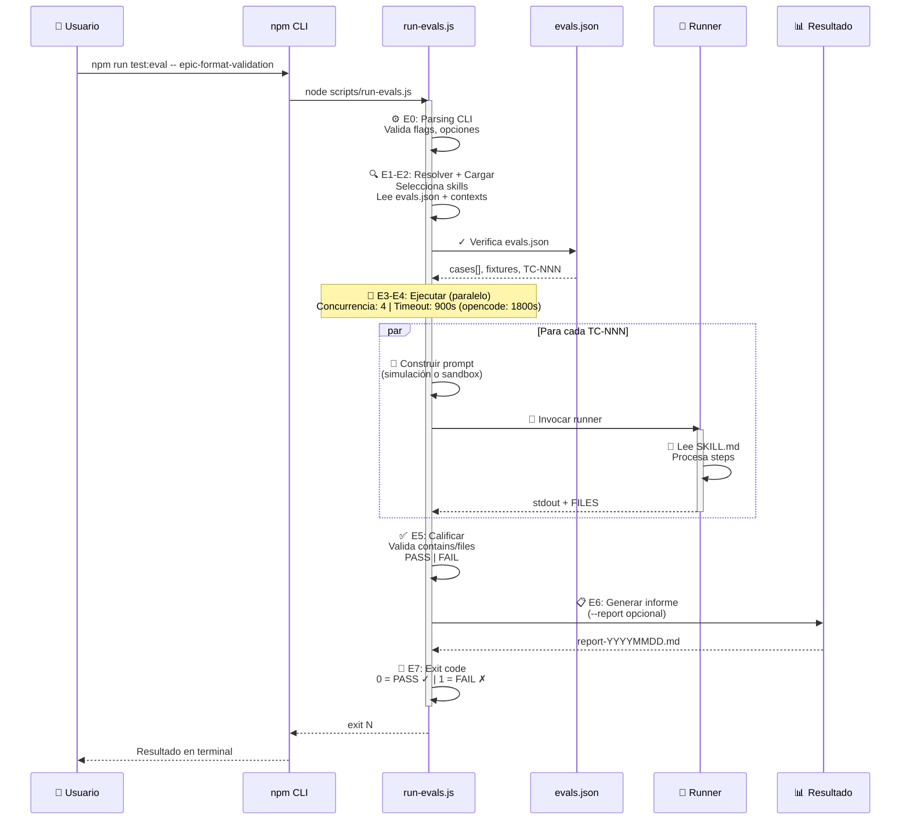

# Sistema de ejecución de pruebas de Skills: `npm run test:eval -- <skill>`

Diagrama de una página, didáctico, del flujo de prueba automatizada de skills.

## El flujo en un diagrama



---

## 7 Fases en 2 minutos

| Fase | Qué hace | Input | Output |
|------|----------|-------|--------|
| **E0** ⚙️ | Parsing CLI | `npm run test:eval -- epic-format-validation --only TC-001` | Opciones normalizadas |
| **E1-E2** 🔍 | Resolver + Cargar | Skill names / --all / --changed-from | `{ skills: [...], cases: [...] }` |
| **E3-E4** 🔄 | Construir + Ejecutar (paralelo) | Escenario de prueba + SKILL.md | Runner invocado (concurrencia 4) |
| **E5** ✅ | Calificar | stdout + expected.contains/files | PASS ✓ o FAIL ✗ |
| **E6** 📋 | Generar informe | --report (opcional) | `report-YYYYMMDD.md` |
| **E7** 🏁 | Exit code | Total de PASS/FAIL | 0 (éxito) o 1 (fallo) |

---

## Modos de ejecución

### 🏃 Simulación (default)
```bash
npm run test:eval -- epic-format-validation
```
- ⚡ Rápido (10-20s)
- Simula ejecución del SKILL.md en seco
- Valida lógica: `expected.contains`, `expected.output_contains`
- Perfecto para TDD y CI/CD

### 🏗️ Sandbox (con `"sandbox": { ... }`)
```bash
npm run test:eval -- epic-format-validation --only TC-016
```
- 🐢 Más lento (30-60s)
- Ejecuta DE VERDAD sobre un directorio desechable
- Valida escrituras: `expected.files.written`, `expected.files.contains`
- Verifica artefactos en disco
- 🧱 El sandbox es su propia raíz Git y el prompt declara su ruta absoluta como REPO_ROOT del ejercicio: los runners que anclan la working directory a la raíz Git (ej. OpenCode) trabajan dentro del sandbox, no del repositorio anfitrión

---

## Ejemplos de uso

```bash
# 🎯 Un skill específico
npm run test:eval -- epic-format-validation

# 📋 Múltiples skills
npm run test:eval -- epic-format-validation story-implement

# 🔍 Solo ciertos casos
npm run test:eval -- epic-format-validation --only TC-001,TC-002

# 🤖 Con runner OpenCode
npm run test:eval -- epic-format-validation --eval-runner opencode

# 📊 Generar informe Markdown
npm run test:eval -- epic-format-validation --report

# 🧪 Todos los skills con evals
npm run test:eval -- --all

# 📡 Skills modificados desde origin/main
npm run test:eval -- --changed-from origin/main

# ⏱️ Caso con debug (no ejecuta runner)
npm run test:eval -- epic-format-validation --dry-run
```

---

## ¿Qué ocurre dentro?

### 1️⃣ Usuario ejecuta comando
```bash
npm run test:eval -- epic-format-validation --only TC-001
```

### 2️⃣ Parsing: Valida flags y opciones
- Runner: claude (por defecto)
- Modelo: sonnet
- Skill: epic-format-validation
- Filtro: Solo TC-001

### 3️⃣ Cargar: Lee manifests
```
skills/epic-format-validation/evals/evals.json
├─ TC-001: { name, description, input, expected, sandbox? }
└─ TC-002: { ... }
```

### 4️⃣ Construir prompt: Inyecta escenario
```
Eres ejecutor de evals. Debes SIMULAR la ejecución de `epic-format-validation`.

Reglas:
- Lee íntegro skills/epic-format-validation/SKILL.md
- Las rutas del escenario son VIRTUALES (del JSON)
- No modifiques nada, solo simula
- Emite EXACTAMENTE el formato esperado

Escenario TC-001:
input: { ... }

Respuesta:
=== CONSOLE ===
<líneas de output>
=== FILE: <ruta> ===
<contenido>
=== END ===
```

### 5️⃣ Ejecutar: Runner procesa prompt
- Lee `SKILL.md` entero
- Procesa steps en orden
- Simula o ejecuta (sandbox)
- Emite `=== CONSOLE ===` + `=== FILE: ===`

### 6️⃣ Calificar: Valida salida
```javascript
// Simulación
if (!stdout.includes("APROBADO")) → FAIL
if (!regex.test(stdout)) → FAIL

// Sandbox
if (!files.includes("specs/flow/EPIC-01/epic.md")) → FAIL
if (!fileContent.includes("estado: READY")) → FAIL
```

### 7️⃣ Resultado
```
✓ TC-001: PASS (12.4s)
✓ TC-002: PASS (8.9s)

Exit code: 0 ✓ (quality gate SUCCESS)
```

---

## Archivos clave

| Ruta | Función |
|------|---------|
| `skills/<skill>/SKILL.md` | Contrato (leído por runner) |
| `skills/<skill>/evals/evals.json` | Casos TC-NNN |
| `skills/<skill>/assets/` | Recursos inyectados |
| `.tmp/skill-test-evals/<skill>/runs/TC-NNN.txt` | Stdout del runner |
| `.tmp/skill-test-evals/<skill>/report-YYYYMMDD.md` | Informe (con --report) |

---

## Variables de entorno

```bash
# Runner por defecto (--eval-runner overrides)
export SDDF_EVAL_RUNNER=claude

# Modelo de Claude (default: sonnet)
export SDDF_EVAL_MODEL=opus

# Modelo de OpenCode (formato: proveedor/modelo)
export SDDF_EVAL_OPENCODE_MODEL=...

# Concurrencia y timeout
# Default por runner: claude/codex 900 s, opencode 1800 s (arranque más lento y modelos locales);
# --timeout explícito prevalece en todos los runners.
npm run test:eval -- --concurrency 8 --timeout 1800
```

---

## Exit codes

| Code | Significado | Acción |
|------|-------------|--------|
| **0** ✅ | Todos los casos PASS | Quality gate SUCCESS → Avanza a siguiente fase |
| **1** ❌ | Algún caso FAIL | Quality gate BLOCKED → No avanza (revisar failures) |
| **2** ⚠️ | Error de CLI/setup | Revisar comando o flags |

---

## Recomendaciones finales

✅ Es recomendable si:
- Lo usas para validar que SKILL.md es claro (no para testing tradicional)
- Ejecutas --only TC-NNN durante desarrollo (no suite completa)
- Usas --dry-run primero (validación gratis)
- Lo haces manualmente (no automático)
- Presupuestas ~$1-2 por skill/año (muy razonable)

❌ NO es recomendable si:
- Esperas que sea como testing unitario (no lo es)
- Lo automatizas en CI/CD (prohibido + caro)
- Lo ejecutas después de cada commit (muy lento + caro)
- Usas para encontrar bugs de implementación (usa tests JS)
- No controlas el presupuesto de tokens
