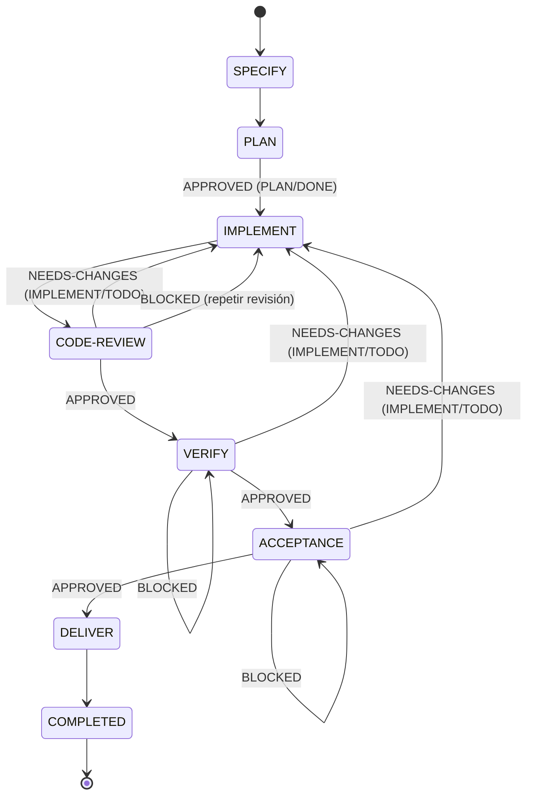

# Documentación del Dominio: Ciclo de Vida de Story (Story Lifecycle)

> **Bounded Context:** Story Lifecycle  
> **Nivel:** L1 — Historia de usuario atómica  
> **Dominio transversal:** [[domain-state-management]]  
> **Fuente canónica de transiciones:** [[state-machine]]  
> **Workflow narrativo:** [[specs-and-workflows]]

---

## 1. Visión General

* **Nombre del dominio:** Ciclo de Vida de Story
* **Objetivo del sistema:** Gobernar el ciclo de vida completo de una historia de usuario, desde su especificación funcional hasta su cierre administrativo, garantizando trazabilidad, calidad y valor entregado mediante transiciones gobernadas por roles, gates de calidad y políticas del proyecto.
* **Principales actores:**
  * **PO / PM** — Define la especificación y acepta el valor de negocio.
  * **Equipo de desarrollo** — Planifica, implementa y verifica la historia.
  * **Revisor** — Ejecuta la revisión de código independiente (humano o IA).
  * **CI/CD** — Ejecuta pruebas automáticas y despliega a producción.
  * **Sistema** — Coordina el pipeline y aplica reglas de WIP.
* **Bounded Contexts relacionados:**
  * **State Management** — Modelo transversal de estados, subestados y transiciones.
  * **Epic Lifecycle** — Contenedor de la historia (una historia pertenece a una épica).
  * **Foundational Docs Lifecycle** — Nivel estratégico documental.
* **Alcance de este documento:** estados específicos, subestados, pipeline, máquina de estados, invariantes, gates y trazabilidad **exclusivos del nivel Story**.

---

## 2. Lenguaje Ubicuo (Glosario)

* **Story:** Historia de usuario atómica que aporta valor de negocio. Identificada por `STORY-NNN`.
* **Pipeline Story:** Secuencia canónica de estados que recorre una historia: `SPECIFY → PLAN → IMPLEMENT → CODE-REVIEW → VERIFY → ACCEPTANCE → DELIVER → COMPLETED` (ADR-0022, [[workflows-sin-estados-buffer]]).
* **Rework:** Retorno a `IMPLEMENT/TODO` tras un `NEEDS-CHANGES` de `CODE-REVIEW`, `VERIFY` o `ACCEPTANCE`. El gate que rechaza escribe `fix-directives.md` en el directorio de la historia, y la presencia de ese archivo es la única señal de rework: no existe estado ni substatus de rework (ADR-0022, [[workflows-sin-estados-buffer]]).
* **DoD (Definition of Done):** Conjunto de criterios que una historia debe cumplir para avanzar de estado.
* **Delivery Model:** Estrategia de entrega del proyecto (`batch` o `continuous`), que determina el significado de `DELIVER`.
* **Incremento potencialmente entregable:** Resultado de una historia que está lista para producción pero aún no publicada (aplica en modelo `batch`).

---

## 3. Modelo Táctico

### Entidades vs. Objetos de Valor

| Elemento | Tipo (Entidad/VO) | ¿Por qué? (Identidad/Inmutabilidad) |
| :--- | :--- | :--- |
| `Story` | Entidad | Tiene identidad única (`STORY-001`) que la rastrea a lo largo de su ciclo de vida. Su estado cambia con el tiempo. |
| `StoryArtifact` | Entidad | Documentos asociados (`story.md`, `design.md`, `tasks.md`, `testcases.md`) con identidad por ruta. |
| `ReviewReport` | Entidad | Reporte de revisión de código (`review.md`) con identidad por ronda de revisión. |
| `VerifyReport` | Entidad | Reporte de verificación (`verify-report.md`) con identidad por ejecución. |
| `StoryStatus` | Objeto de Valor | Inmutable. Conjunto cerrado de 9 estados específicos del nivel Story. |
| `StorySubstatus` | Objeto de Valor | Inmutable. Heredado del dominio transversal: `TODO`, `IN-PROGRESS`, `DONE`, `BLOCKED`. |
| `DeliveryModel` | Objeto de Valor | Inmutable. Valores: `batch`, `continuous`. Determina el significado de `DELIVER`. |
| `ReworkEvent` | Objeto de Valor | Inmutable. Se define por origen (revisión/verificación/aceptación), motivo y ronda. |
| `StoryParent` | Objeto de Valor | Inmutable. Referencia a la `Epic` contenedora (`EPIC-NNN`). |

### Agregado y Aggregate Root (AR)

* **Agregado Principal:** `Story` (AR)
* **Contenido interno:**
  * `StoryStatus` (VO)
  * `StorySubstatus` (VO)
  * `StoryArtifact` (Entidad) — `story.md` como artefacto principal
  * `StoryArtifact` (Entidad) — artefactos secundarios (`design.md`, `tasks.md`, `testcases.md`)
  * `ReviewReport` (Entidad) — reportes de revisión
  * `VerifyReport` (Entidad) — reportes de verificación
  * `ReworkEvent` (VO) — historial de reworks
  * `DeliveryModel` (VO) — determina el significado de `DELIVER`
  * `StoryParent` (VO) — referencia a la épica contenedora
  * `WipLimit` (VO) — aplicable solo a `substatus: IN-PROGRESS` (constitución §9)

---

## 4. Pipeline de Estados

### 4.1 Happy path

```
SPECIFY → PLAN → IMPLEMENT → CODE-REVIEW → VERIFY → ACCEPTANCE → DELIVER → COMPLETED
```

Fuente del workflow y de sus transiciones: ADR-0022, [[workflows-sin-estados-buffer]].

### 4.2 Máquina de estados completa (con retrocesos)



### 4.3 Rutas alternativas

| Ruta | Descripción |
|------|-------------|
| **Happy path** | `SPECIFY → PLAN → IMPLEMENT → CODE-REVIEW → VERIFY → ACCEPTANCE → DELIVER → COMPLETED` |
| **Rework por revisión** | `CODE-REVIEW → IMPLEMENT/TODO` (`NEEDS-CHANGES`) |
| **Revisión incompleta** | `CODE-REVIEW → IMPLEMENT/DONE` (`BLOCKED`; repetir `story-code-review`) |
| **Rework por verificación** | `VERIFY → IMPLEMENT/TODO` (`NEEDS-CHANGES`) |
| **Rework por aceptación** | `ACCEPTANCE → IMPLEMENT/TODO` (`NEEDS-CHANGES`) |
| **Bloqueo en aceptación** | `ACCEPTANCE → ACCEPTANCE` (`BLOCKED`) |
| **Bloqueo en verificación** | `VERIFY → VERIFY` (`BLOCKED`) |
| **Cancelación** | `* → CANCELED` (desde cualquier estado activo) |
| **Entrega forzada** | `* → DELIVER/DONE` desde cualquier historia no archivada, vía `/story-delivery --force`; omite la precondición `ACCEPTANCE/DONE` y el DoD de entrega incumplido, exige confirmación humana y registra el override en `delivery-report.md` |

---

## 5. Tabla de Estados

| Status | Descripción | Actor | Substatus inicial |
|--------|-------------|-------|-------------------|
| `SPECIFY` | Se define el comportamiento de la historia: formato Como/Quiero/Para, criterios de aceptación con escenarios Gherkin. Fase funcional sin decisiones técnicas. | PO / PM | `IN-PROGRESS` |
| `PLAN` | Se diseña la solución técnica: `design.md`, `tasks.md`, `testcases.md`. Se estima esfuerzo y se define el enfoque (TDD/BDD). Termina en `PLAN/DONE` cuando `story-analyze` emite `APPROVED`. | Equipo | `IN-PROGRESS` |
| `IMPLEMENT` | Se codifica la historia siguiendo TDD/BDD (Rojo-Verde-Refactor). Se escriben pruebas y código de producción. `IMPLEMENT/TODO` indica un rework pendiente si existe `fix-directives.md`. | Equipo / IA | `IN-PROGRESS` |
| `CODE-REVIEW` | Se revisa el código implementado para garantizar calidad, estándares y coherencia con el diseño. | Revisor | `IN-PROGRESS` |
| `VERIFY` | Se ejecutan pruebas automatizadas (unitarias, integración, E2E, regresión) en entorno controlado. | CI / Equipo | `IN-PROGRESS` |
| `ACCEPTANCE` | Validación humana de la historia contra los criterios de aceptación de `SPECIFY`. El humano decide si el valor es entregable. | PO / QA | `IN-PROGRESS` |
| `DELIVER` | Incremento listo para producción (batch) o ya desplegado (continuous). La escribe `story-delivery` tras verificar el DoD de entrega y con confirmación humana. | Humano (vía `story-delivery`) / CI-CD | `DONE` |
| `COMPLETED` | Estado terminal pasivo. Sin acciones pendientes. Permite medir tiempos de ciclo sin reabrir artefactos. La escribe `story-complete` desde `DELIVER/DONE` con confirmación humana y archiva la historia en `specs/flow/archive/<YYYY-MM-DD>-STORY-NNN-<slug>/`; las historias ya `COMPLETED/DONE` se archivan sin cambiar su status. | Humano (vía `story-complete`) | `DONE` |
| `CANCELED` | La historia fue cancelada sin entregar. Estado terminal. `story-complete` la archiva sin cambiar el status, con confirmación humana. | PO / PM | `DONE` |

---

## 6. Subestados Aplicables

| Substatus | Aplica en | Significado específico en Story |
|-----------|-----------|--------------------------------|
| `TODO` | Cualquier estado activo | Pendiente de iniciar; en `IMPLEMENT/TODO` con `fix-directives.md`, rework pendiente. |
| `IN-PROGRESS` | `SPECIFY`, `PLAN`, `IMPLEMENT`, `CODE-REVIEW`, `VERIFY`, `ACCEPTANCE`, `DELIVER` | El rol correspondiente está trabajando activamente. |
| `DONE` | Todos los estados activos | Trabajo de la etapa terminado; `PLAN/DONE` es la planificación aprobada, lista para implementar. |
| `BLOCKED` | `ACCEPTANCE` principalmente; puede aplicar a cualquier estado activo | Impedimento externo (ej. dependencia, decisión pendiente). No retrocede el status. |

---

## 7. Invariantes Específicas de Story

Además de las invariantes transversales de [[domain-state-management]]:

1. Una `Story` **siempre pertenece a una `Epic`** (`parent: EPIC-NNN` en el frontmatter).
2. Una `Story` solo puede estar en **un estado del pipeline Story** a la vez.
3. El estado `DELIVER` tiene **dos significados** según el `DeliveryModel`:
   * `batch`: incremento listo para producción, aún no publicado.
   * `continuous`: incremento ya desplegado en producción.
4. El estado `COMPLETED` no puede retroceder sin acción explícita de reapertura.
5. La transición `ACCEPTANCE → ACCEPTANCE` (con `BLOCKED`) mantiene el estado, pero documenta el impedimento.
6. Todos los retrocesos por `NEEDS-CHANGES` apuntan a `IMPLEMENT/TODO`; no existe estado ni substatus de rework y la señal es `fix-directives.md` (ADR-0022, [[workflows-sin-estados-buffer]]).
7. Las historias listas para implementar se consultan en este orden: primero `IMPLEMENT/TODO`, después `PLAN/DONE`. Es una consulta, no un estado ni una cola con WIP ([[domain-state-management]] §5.5).
8. El estado terminal `COMPLETED` no admite transiciones salientes excepto `CANCELED` o reapertura explícita.

---

## 8. Gates de Calidad Específicos

| Gate | Estado | Qué valida |
|------|--------|------------|
| **CI en el PR** | `CODE-REVIEW` | Compilación, tests unitarios, linters. |
| **Revisión por pares** | `CODE-REVIEW` | Diseño, seguridad, estándares, coherencia con `design.md`. |
| **CI post-merge** | `VERIFY` | Integración, E2E, regresión. |
| **DoD de Story** | `VERIFY` | Criterios de la Definition of Done de Story (cobertura, pruebas, documentación). |
| **Aceptación del PO** | `ACCEPTANCE` | Criterios de aceptación de `story.md`, valor de negocio. |

---

## 9. Trazabilidad y Persistencia

* **Frontmatter de `story.md`** con `status`, `substatus`, `parent`, `deliveryModel`.
* **`TransitionHistory`** inmutable con cada cambio de estado (fecha, origen, destino, actor, motivo).
* **`ReworkEvent`** registrado cada vez que la historia retrocede, con ronda y motivo.
* **Reportes asociados:**
  * `review.md` — generado en cada ronda de `CODE-REVIEW`.
  * `verify-report.md` — generado en `VERIFY`.
  * `acceptance-report.md` (opcional) — generado en `ACCEPTANCE`.
* **Archivo:** las historias `COMPLETED` y `CANCELED` (con `substatus: DONE`) se archivan en `specs/flow/archive/<YYYY-MM-DD>-STORY-NNN-<slug>/` conservando su status, con la fecha de `updated:`, `created:` o `date:` (ADR-0017). El status es lo que distingue en el archivo una historia entregada de una cancelada.
* **Reapertura:** solo desde `COMPLETED` con acción explícita y registro del motivo.
* **Convención de guion:** ASCII U+002D `-`.

---

## 10. Fuentes de Verdad

* **Esquema canónico de frontmatter:** `header-aggregation/SKILL.md`
* **Máquina de estados completa:** [[state-machine]]
* **Workflow narrativo:** [[specs-and-workflows]]
* **Dominio transversal:** [[domain-state-management]]
* **Principios aplicables:** [[constitution]] (patrones 8, 14; reglas 9 y 15)
* **Decisión de arquitectura:** [[workflows-sin-estados-buffer]] (ADR-0022) — fuente del workflow y las transiciones de story; [[workflow-canonico-story-y-epic]] (ADR-0003) — rationale de los nombres de `status` en infinitivo

---

## 11. Referencias Cruzadas

* [[domain-state-management]] — Modelo transversal de estados y transiciones
* [[domain-epic-lifecycle]] — Ciclo de vida de Epic (contenedor de Story)
* [[domain-foundational-docs-lifecycle]] — Ciclo de vida de la documentación fundacional
* [[constitution]] — Constitución del proyecto
* [[workflow-canonico-story-y-epic]] — Workflow canónico de story y epic (nombres en infinitivo)
* [[workflows-sin-estados-buffer]] — ADR-0022: workflows de story y epic, rework en `IMPLEMENT/TODO` y cola de listos como consulta

