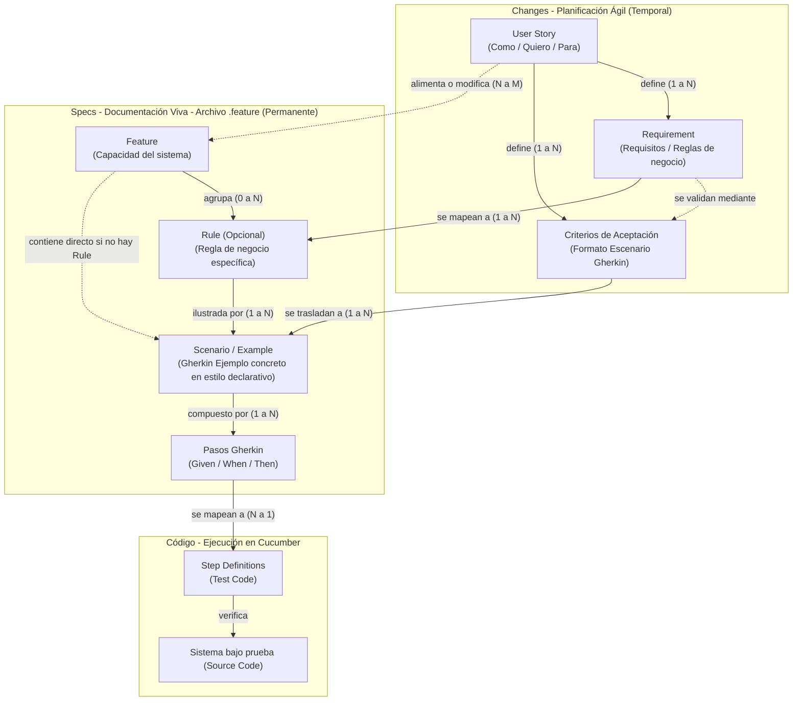

# Story vs Feature

Una Story (o User Story) es una unidad de trabajo y planificación de un cambio, que captura una necesidad del usuario y su contexto, generalmente siguiendo el formato `Como / Quiero / Para`. 
Contiene Criterios de Aceptación generalmente escritos como escenarios Gherkin.
Puede contener requerimientos (Requirement) funcionales (FRs) o no funcionales (NFRs).

Una Story se corresponde con Features y Scenarios dentro de la documentación viva.

