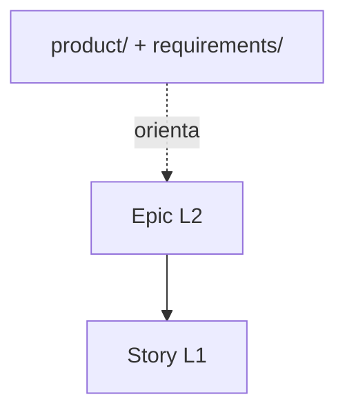

# Documentación del Dominio: Jerarquía de Work Items

> **Bounded Context:** Work Item Hierarchy  
> Epic y Story son los únicos work items; `product/` y `requirements/` son documentación estratégica.

## 1. Visión General

La jerarquía tiene dos niveles: Epic (L2, coordinación) y Story (L1, operativo). La documentación fundacional los orienta, pero no es un work item.

## 2. Lenguaje Ubicuo (Glosario)

| Término | Definición |
|---|---|
| Nivel estratégico | `product/` y `requirements/`; sin pipeline, parent ni WIP. |
| Epic | Work item L2 y raíz de la jerarquía. |
| Story | Work item L1 que pertenece a una Epic. |
| ParentRef | `null` para Epic; `EPIC-NN` para Story. |
| FolderSegment | `epics` o `stories`. |

## 3. Modelo Táctico

| Entidad | Level | ParentRef | FolderSegment |
|---|---|---|---|
| Epic | L2 | `null` | `epics` |
| Story | L1 | `EPIC-NN` | `stories` |



## 4. Árbol de Jerarquía

```text
product/ + requirements/
└── specs/flow/EPIC-NN-<slug>/epic.md
    └── specs/flow/STORY-NNN-<slug>/story.md
```

## 5. Cardinalidad e Invariantes

| Work item | Parent | Hijos |
|---|---|---|
| Epic | ninguno | 0..N Stories |
| Story | exactamente una Epic | ninguno |

1. Una Story no existe sin Epic.
2. La integridad referencial solo conecta Story → Epic.
3. Epic es raíz y tiene `parent: null`.
4. No hay saltos de jerarquía.
5. La trazabilidad estratégica usa requisitos y `product/roadmap.md`, no `parent`.
6. Los documentos fundacionales no son work items.

## 6. Nomenclatura y Flight Levels

| Nivel | Dónde vive | Naturaleza | Identificador |
|---|---|---|---|
| Estratégico | `product/` + `requirements/` | documentación fundacional | `FR-NNN` / `NFR-NNN` |
| L2 | `specs/flow/EPIC-NN-<slug>/` | Epic | `EPIC-NN` |
| L1 | `specs/flow/STORY-NNN-<slug>/` | Story | `STORY-NNN` |

## 7. Estructura de Carpetas

`specs/flow/` (raíz del repo) contiene épicas (`EPIC-NN-<slug>/`) e historias (`STORY-NNN-<slug>/`) como directorios hermanos, sin subniveles ni prefijos numéricos. Las historias `COMPLETED` se archivan en `specs/flow/archive/<YYYY-MM-DD>-STORY-NNN-<slug>/` ([[layout-fijo-de-tres-raices]]).

> Hasta 3.x existía un nivel Project en `specs/01-projects/`; ver [[asegurar-dos-niveles-de-flujo-epics-stories]].

## 8. Resolución

Las Epics se resuelven en `specs/flow/EPIC-NN-<slug>/epic.md` y las Stories en `specs/flow/STORY-NNN-<slug>/story.md`; una Story archivada se resuelve en `specs/flow/archive/<YYYY-MM-DD>-STORY-NNN-<slug>/story.md`.

## 9. Validación

Se validan prefijos, archivo canónico y que `Story.parent` resuelva a una Epic.

## 10. Fuentes de Verdad

- [[domain-foundational-docs-lifecycle]]
- [[domain-epic-lifecycle]]
- [[domain-story-lifecycle]]
- [[state-machine]]

## 11. Referencias Cruzadas

- [[domain-foundational-docs-lifecycle]]
- [[asegurar-dos-niveles-de-flujo-epics-stories]]
